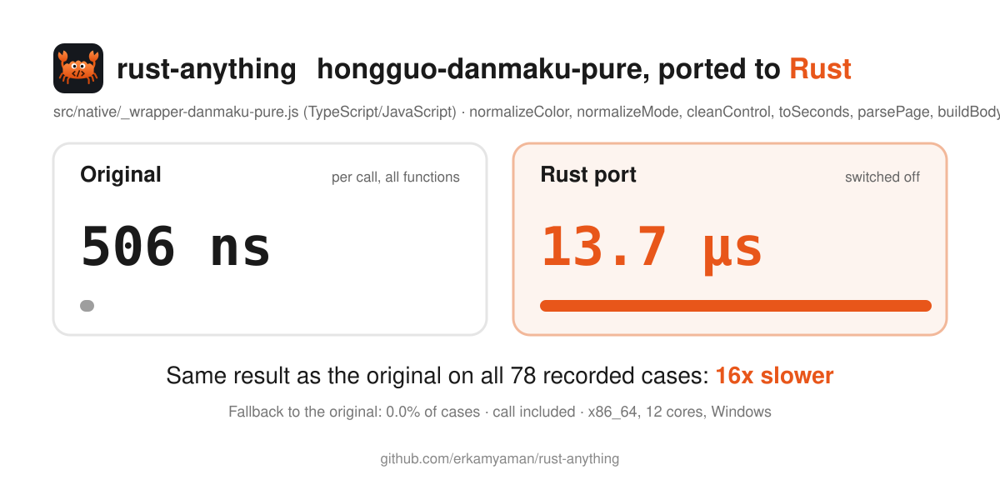

## `hongguo-danmaku-pure` in Rust

| | |
| --- | --- |
| Unit | `src/native/_wrapper-danmaku-pure.js` (TypeScript/JavaScript) |
| Recorded cases matched | 78 / 78 |
| Speedup, call included | 0.1x (geometric mean) |
| Fallback to the original | 0.0% (0 of 78 cases) |
| Switched on | off |

| Function | Cases | Original per call | Rust per call | Speedup |
| --- | ---: | ---: | ---: | ---: |
| `normalizeColor` | 25 | 52 ns | 382 ns | 0.1x |
| `normalizeMode` | 12 | 70 ns | 1.2 µs | 0.1x |
| `cleanControl` | 10 | 94 ns | 383 ns | 0.2x |
| `toSeconds` | 19 | 18 ns | 123 ns | 0.1x |
| `buildBody` | 3 | 27 ns | 6.7 µs | 0.0x |
| `parsePage` | 9 | 245 ns | 5.0 µs | 0.0x |

Measured with `rust-anything report` on x86_64, 12 cores, Windows: `diff` replays every recorded case, `bench` times them on both sides as callers call them. Reproduce: `rust-anything diff` and `rust-anything bench` in the crate folder.
