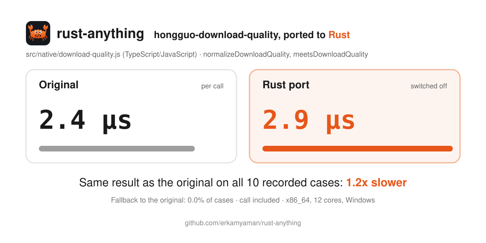

## `hongguo-download-quality` in Rust

| | |
| --- | --- |
| Unit | `src/native/download-quality.js` (TypeScript/JavaScript) |
| Recorded cases matched | 10 / 10 |
| Speedup, call included | 0.8x (geometric mean) |
| Fallback to the original | 0.0% (0 of 10 cases) |
| Switched on | off |

| Function | Cases | Original per call | Rust per call | Speedup |
| --- | ---: | ---: | ---: | ---: |
| `meetsDownloadQuality` | 10 | 2.4 µs | 2.9 µs | 0.8x |

Measured with `rust-anything report` on x86_64, 12 cores, Windows: `diff` replays every recorded case, `bench` times them on both sides as callers call them. Reproduce: `rust-anything diff` and `rust-anything bench` in the crate folder.
