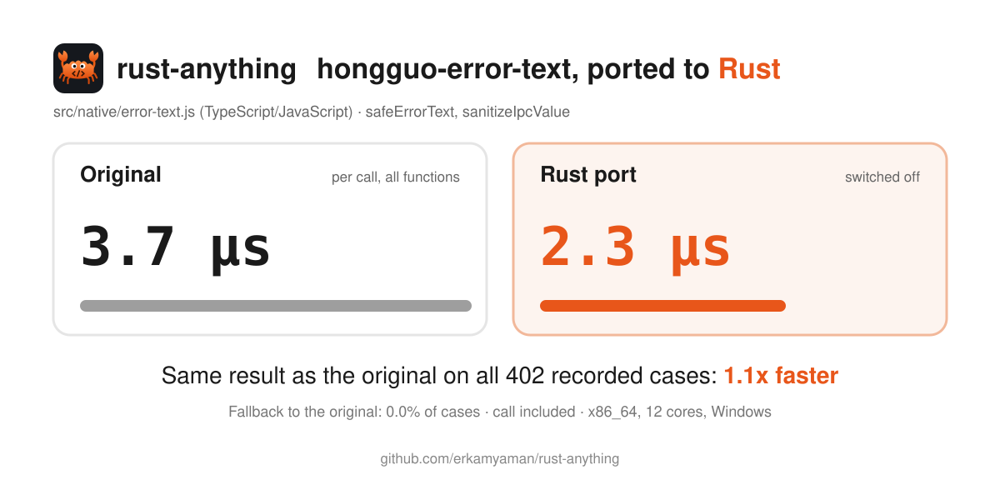

## `hongguo-error-text` in Rust

| | |
| --- | --- |
| Unit | `src/native/error-text.js` (TypeScript/JavaScript) |
| Recorded cases matched | 402 / 402 |
| Speedup, call included | 1.1x (geometric mean) |
| Fallback to the original | 0.0% (0 of 402 cases) |
| Switched on | off |

| Function | Cases | Original per call | Rust per call | Speedup |
| --- | ---: | ---: | ---: | ---: |
| `safeErrorText` | 190 | 470 ns | 1.0 µs | 0.5x |
| `sanitizeIpcValue` | 212 | 3.2 µs | 1.3 µs | 2.5x |

Measured with `rust-anything report` on x86_64, 12 cores, Windows: `diff` replays every recorded case, `bench` times them on both sides as callers call them. Reproduce: `rust-anything diff` and `rust-anything bench` in the crate folder.
