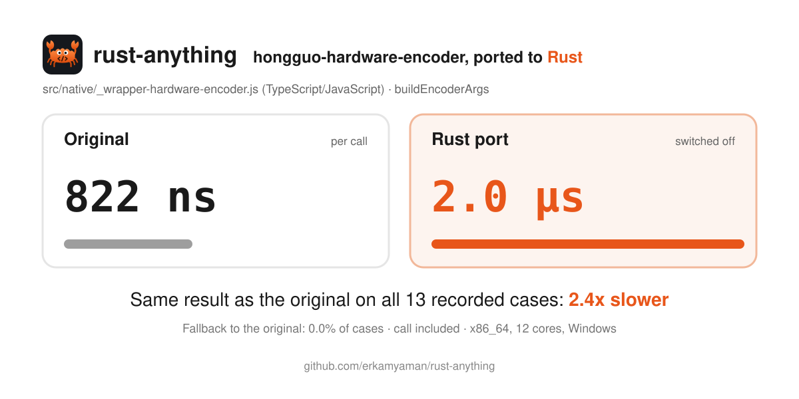

## `hongguo-hardware-encoder` in Rust

| | |
| --- | --- |
| Unit | `src/native/_wrapper-hardware-encoder.js` (TypeScript/JavaScript) |
| Recorded cases matched | 13 / 13 |
| Speedup, call included | 0.4x (geometric mean) |
| Fallback to the original | 0.0% (0 of 13 cases) |
| Switched on | off |

| Function | Cases | Original per call | Rust per call | Speedup |
| --- | ---: | ---: | ---: | ---: |
| `buildEncoderArgs` | 13 | 822 ns | 2.0 µs | 0.4x |

Measured with `rust-anything report` on x86_64, 12 cores, Windows: `diff` replays every recorded case, `bench` times them on both sides as callers call them. Reproduce: `rust-anything diff` and `rust-anything bench` in the crate folder.
