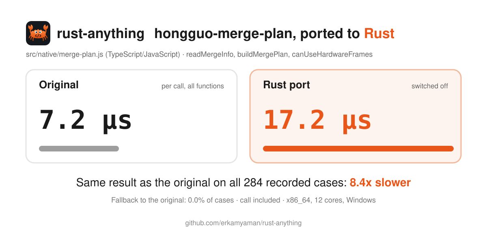

## `hongguo-merge-plan` in Rust

| | |
| --- | --- |
| Unit | `src/native/merge-plan.js` (TypeScript/JavaScript) |
| Recorded cases matched | 284 / 284 |
| Speedup, call included | 0.1x (geometric mean) |
| Fallback to the original | 0.0% (0 of 284 cases) |
| Switched on | off |

| Function | Cases | Original per call | Rust per call | Speedup |
| --- | ---: | ---: | ---: | ---: |
| `readMergeInfo` | 30 | 1.9 µs | 9.8 µs | 0.2x |
| `buildMergePlan` | 155 | 5.3 µs | 6.1 µs | 0.9x |
| `canUseHardwareFrames` | 99 | 13 ns | 1.3 µs | 0.0x |

Measured with `rust-anything report` on x86_64, 12 cores, Windows: `diff` replays every recorded case, `bench` times them on both sides as callers call them. Reproduce: `rust-anything diff` and `rust-anything bench` in the crate folder.
