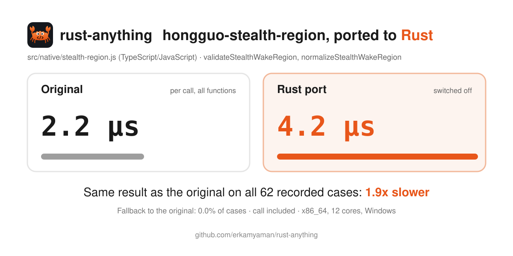

## `hongguo-stealth-region` in Rust

| | |
| --- | --- |
| Unit | `src/native/stealth-region.js` (TypeScript/JavaScript) |
| Recorded cases matched | 62 / 62 |
| Speedup, call included | 0.5x (geometric mean) |
| Fallback to the original | 0.0% (0 of 62 cases) |
| Switched on | off |

| Function | Cases | Original per call | Rust per call | Speedup |
| --- | ---: | ---: | ---: | ---: |
| `validateStealthWakeRegion` | 31 | 945 ns | 2.6 µs | 0.4x |
| `normalizeStealthWakeRegion` | 31 | 1.2 µs | 1.6 µs | 0.7x |

Measured with `rust-anything report` on x86_64, 12 cores, Windows: `diff` replays every recorded case, `bench` times them on both sides as callers call them. Reproduce: `rust-anything diff` and `rust-anything bench` in the crate folder.
