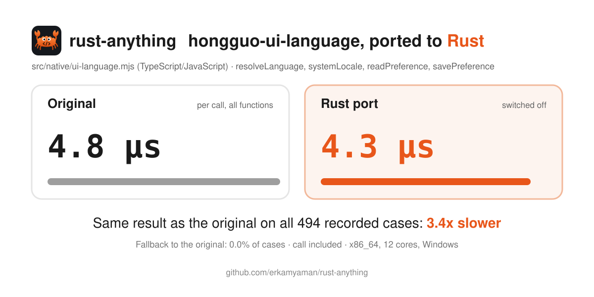

## `hongguo-ui-language` in Rust

| | |
| --- | --- |
| Unit | `src/native/ui-language.mjs` (TypeScript/JavaScript) |
| Recorded cases matched | 494 / 494 |
| Speedup, call included | 0.3x (geometric mean) |
| Fallback to the original | 0.0% (0 of 494 cases) |
| Switched on | off |

| Function | Cases | Original per call | Rust per call | Speedup |
| --- | ---: | ---: | ---: | ---: |
| `resolveLanguage` | 115 | 38 ns | 685 ns | 0.1x |
| `systemLocale` | 252 | 29 ns | 782 ns | 0.0x |
| `readPreference` | 20 | 3.5 µs | 524 ns | 6.8x |
| `savePreference` | 107 | 1.2 µs | 2.3 µs | 0.5x |

Measured with `rust-anything report` on x86_64, 12 cores, Windows: `diff` replays every recorded case, `bench` times them on both sides as callers call them. Reproduce: `rust-anything diff` and `rust-anything bench` in the crate folder.
