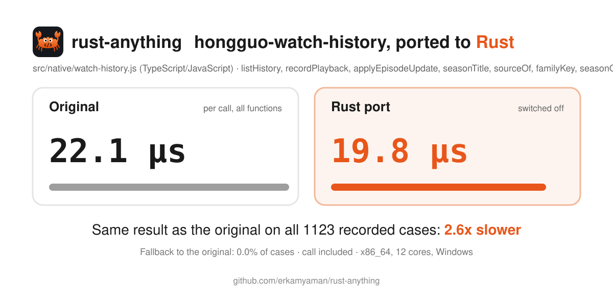

## `hongguo-watch-history` in Rust

| | |
| --- | --- |
| Unit | `src/native/watch-history.js` (TypeScript/JavaScript) |
| Recorded cases matched | 1123 / 1123 |
| Speedup, call included | 0.4x (geometric mean) |
| Fallback to the original | 0.0% (0 of 1123 cases) |
| Switched on | off |

| Function | Cases | Original per call | Rust per call | Speedup |
| --- | ---: | ---: | ---: | ---: |
| `listHistory` | 207 | 16.0 µs | 2.3 µs | 6.9x |
| `recordPlayback` | 215 | 1.0 µs | 3.2 µs | 0.3x |
| `applyEpisodeUpdate` | 212 | 995 ns | 4.1 µs | 0.2x |
| `seasonTitle` | 20 | 267 ns | 1.9 µs | 0.1x |
| `sourceOf` | 21 | 77 ns | 433 ns | 0.2x |
| `familyKey` | 16 | 195 ns | 1.3 µs | 0.2x |
| `seasonOf` | 16 | 138 ns | 1.1 µs | 0.1x |
| `findSequels` | 220 | 1.6 µs | 1.0 µs | 1.6x |
| `findSimilarSeries` | 95 | 342 ns | 1.4 µs | 0.2x |
| `sequelKeyword` | 12 | 376 ns | 706 ns | 0.5x |
| `acknowledge` | 89 | 1.1 µs | 2.3 µs | 0.5x |

Measured with `rust-anything report` on x86_64, 12 cores, Windows: `diff` replays every recorded case, `bench` times them on both sides as callers call them. Reproduce: `rust-anything diff` and `rust-anything bench` in the crate folder.
